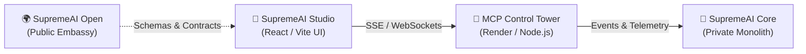

# 🎨 SupremeAI Studio

> **User-Facing React/Vite UI & Live Federation Command Surface**  
> **Part of the [SupremeAI Federation](https://github.com/Supremeai-bd/supremeai-open)**

---

## 🌟 Overview

**SupremeAI Studio** is the flagship web experience and frontend command surface for the SupremeAI ecosystem. Built with React, Vite, and TypeScript, it exposes a state-of-the-art glassmorphism user experience for monitoring autonomous agents, viewing federated repository statuses, and orchestrating AI workflows.

---

## ⚡ Key Capabilities

- **Live Federation Command Dashboard:** Real-time telemetry monitoring active execution slots, token burn rate, and health metrics across all 12 federation repositories.
- **Dual Transport Telemetry Stream:** Seamless connection to the live SupremeAI MCP Tower over Server-Sent Events (`/sse`) and WebSockets with auto-reconnect and offline failover simulation.
- **Dark & Light Glassmorphism UI:** Precision token-driven design system with frosted glass surfaces, accessible color contrast (≥ 4.5:1), and fluid typography.
- **Zero Third-Party Tracking:** 100% self-contained frontend with zero invasive external scripts and fail-closed schema validation.

---

## 🏗️ Architecture & Federation Topology



- **Contract SSOT:** Adheres strictly to [`dashboard.schema.json`](https://github.com/Supremeai-bd/supremeai-open/blob/main/api-schemas/dashboard.schema.json).
- **Public Boundary:** Exposes the UI and telemetry views without leaking proprietary core backend logic or private credentials.

---

## 🚀 Quick Start

### Prerequisites
- Node.js ≥ 20.x or 24.x
- `pnpm` ≥ 9.x

### Installation

```bash
# Clone the repository
git clone https://github.com/Supremeai-bd/supremeai-studio.git
cd supremeai-studio

# Install dependencies
pnpm install
```

### Development Server

```bash
# Launch Vite development server
pnpm dev
```
Open [http://localhost:5173](http://localhost:5173) in your browser.

### Verification & Testing

```bash
# Typecheck
pnpm typecheck

# Unit & component test suite
pnpm test

# E2E test suite
pnpm test:e2e
```

### Production Build

```bash
pnpm build
```

---

## 🛡️ Governance & Quality Standard

- **Zero-Admin Policy:** PRs pass automated CI gates (branch naming, parity checks, tests, and secret scans) before autonomous landing.
- **Accessibility:** Fully keyboard navigable (`:focus-visible`), aria landmarks, and respects `prefers-reduced-motion`.
- **License:** MIT License.
